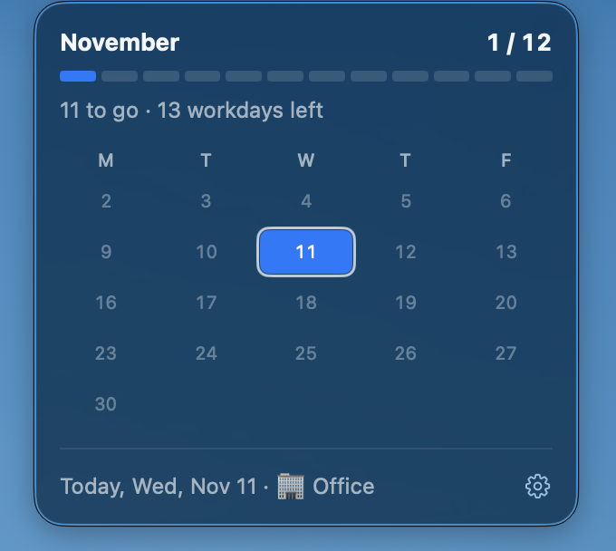
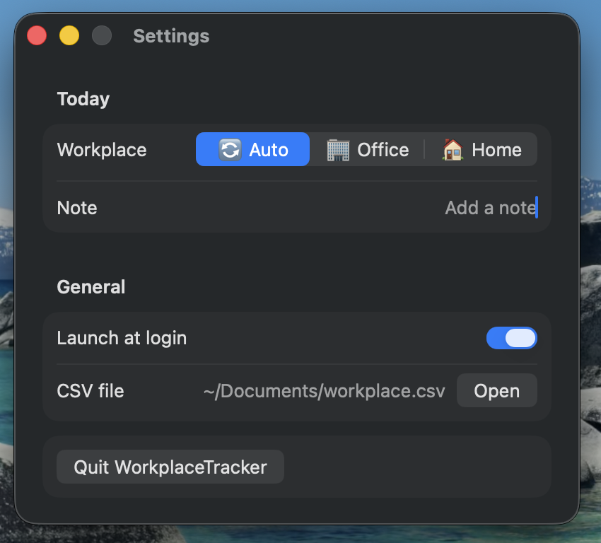

# WorkplaceTracker

A macOS menu bar app that records, for each day, whether you worked at the office or from home, based on the connected Wi-Fi network.

 

- Connected to the office SSID → `office`; any other network → `home`.
- No Wi-Fi → nothing is recorded.
- Office wins: if the office network is seen at any point during the day, the day stays `office`.
- Monthly office target (12 by default): the panel shows how many office days are left, how many workdays remain, and a Mon–Fri grid of the month.
- The menu bar icon shows today's workplace, colored by how the target is going: monochrome when on track, orange with one home day to spare or less, red when the target can't be reached anymore, green when it's done.
- Settings (gear icon or ⌘,): manual override for today only ("Auto" goes back to detection), a free-text note per day (empty by default), launch at login, the CSV and config files, and Quit.

## Configuration

Set your office network name in `~/.config/workplace-tracker/config.json`:

```json
{ "officeSSID": "Office-WiFi", "csvPath": "~/Documents/workplace.csv", "monthlyTarget": 12 }
```

`officeSSID` is required: until it is set, the panel shows a warning and nothing is recorded. `csvPath` defaults to `~/Documents/workplace.csv` and `monthlyTarget` to 12. Changes take effect when the app restarts.

Workdays left are the weekdays after today, so the count never assumes you'll still make it to the office today.

## Build and install

```bash
./scripts/build-app.sh --install
```

This builds the app, installs it into `~/Applications` and launches it.

On first launch macOS asks for Location access. Grant it: without it, macOS hides the Wi-Fi network name from apps. Then enable "Launch at Login" from the menu.

The app is ad-hoc signed, so macOS may ask for Location access again after each rebuild.

## Tests

```bash
./scripts/test.sh
```

The script works with both Xcode and the Command Line Tools alone.

## CSV

One row per day:

```csv
date,status,source,updated_at,note
2026-11-11,office,auto,2026-11-11T09:14:02+01:00,
2026-11-12,home,manual,2026-11-12T10:02:11+01:00,"dentist, then remote"
```

The file is re-read on every check, so you can also edit it by hand. Notes containing commas or quotes are quoted following the CSV standard; line breaks become spaces.
